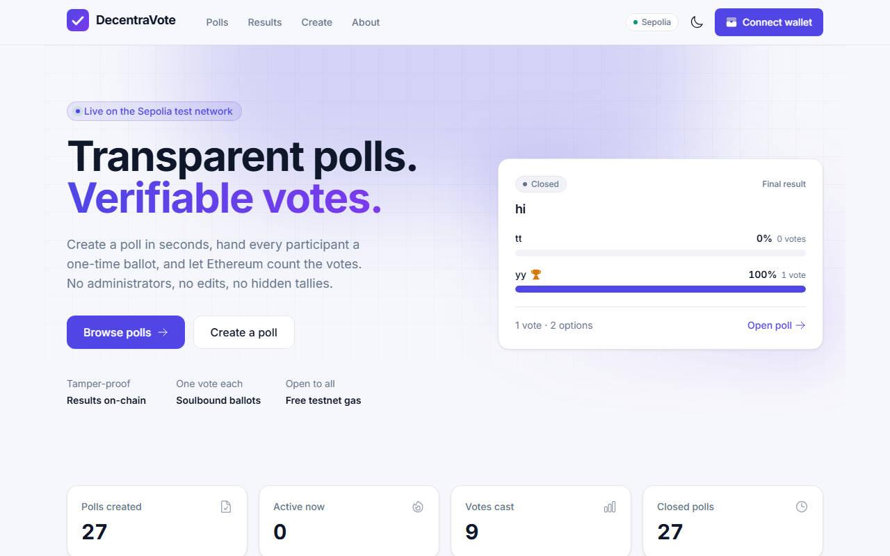
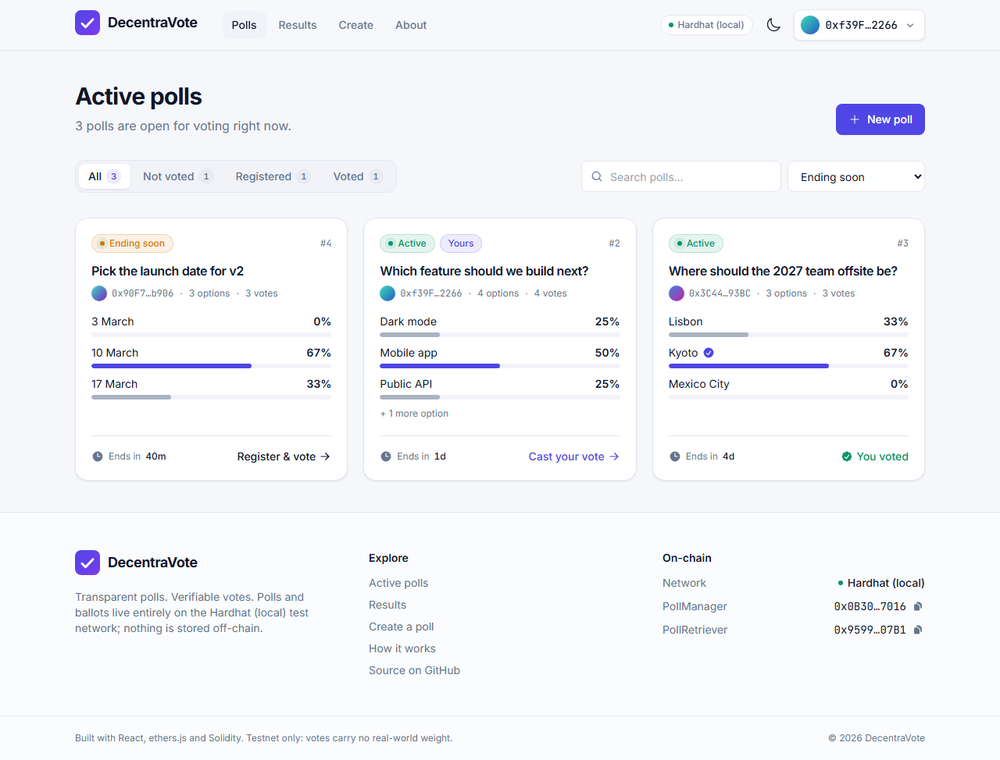
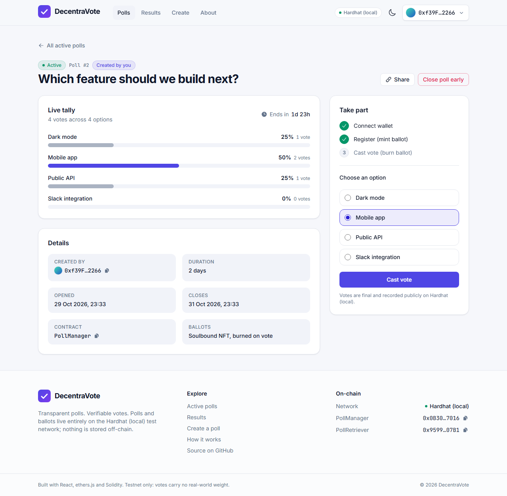
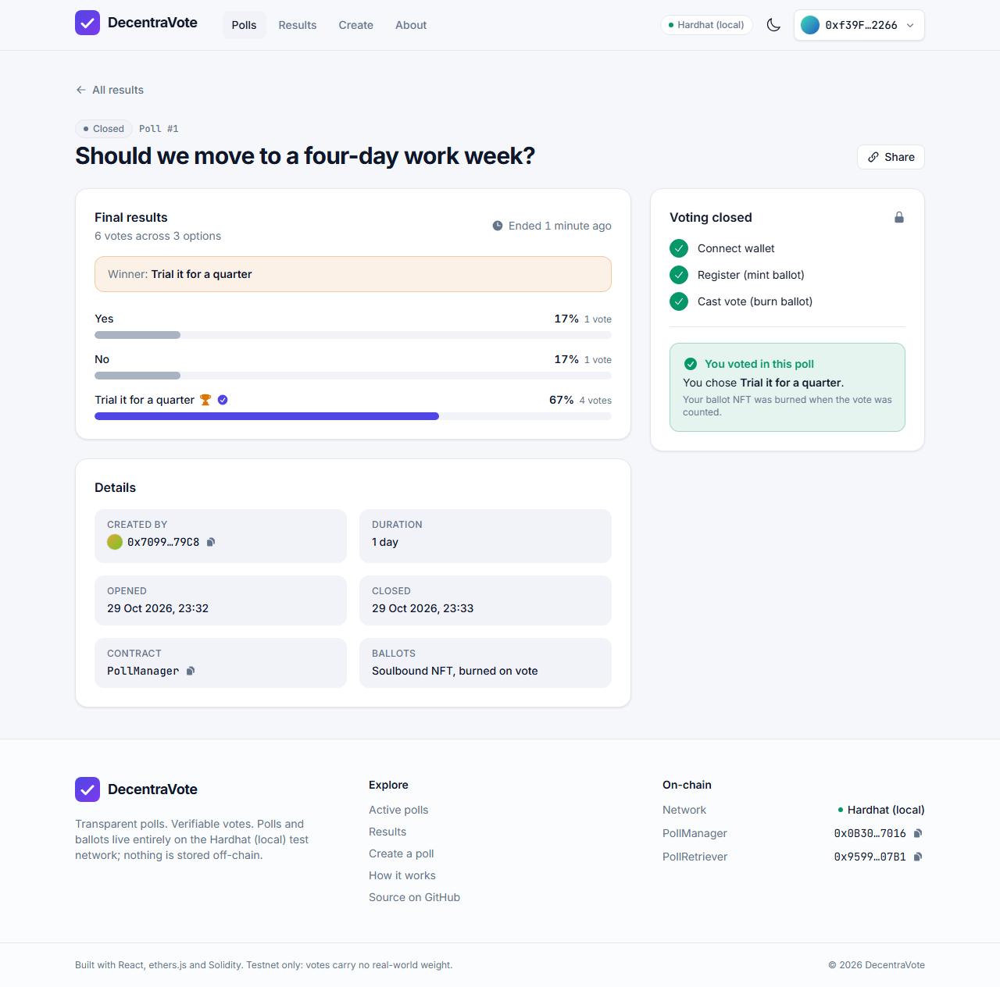
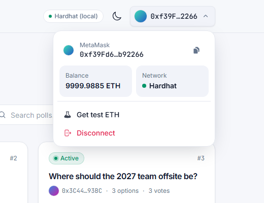
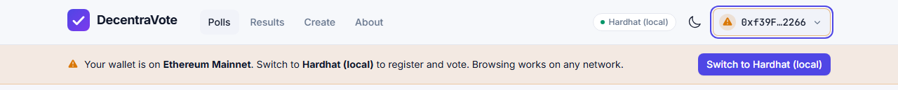
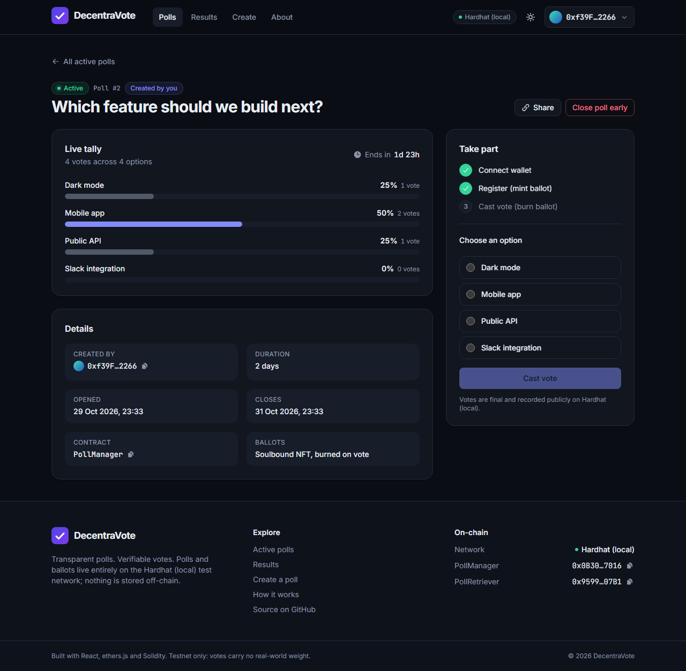
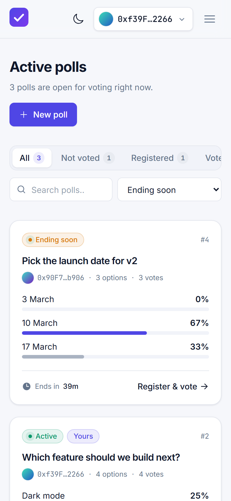
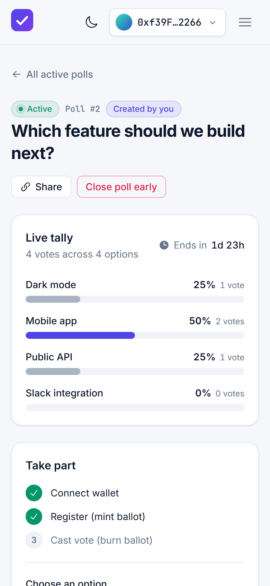

# DecentraVote

A decentralised polling app on Ethereum. Anyone can create a poll, register for it (which mints a soulbound ballot NFT) and cast a single vote (which burns the ballot). Every poll, ballot and vote is a public transaction on the **Sepolia** test network, so results are tamper-proof and verifiable by anyone.

**Live app:** https://joshpanebianco-io.github.io/voting-dapp/



## Screenshots

**Active polls.** Each card shows the live tally, the time left and where you stand: not yet registered, registered, or voted.



**Voting.** The poll page walks through the three on-chain steps. Once registered, pick an option and cast your vote; the ballot NFT is burned in the same transaction.



**Results.** Closed polls show the final tally with the winner highlighted, plus your own choice if you took part.



**Creating a poll.** Title, 2–10 options and a duration, with a live preview. One transaction publishes it.


**Wallet handling.** Balance, network and faucet links live in the wallet menu. If the wallet is on the wrong chain the app says so and offers a one-click switch.

<p>
  
</p>



**Dark mode and mobile.**



<p>
  
  &nbsp;&nbsp;
  
</p>

## Features

- **Polls** with 2–10 options and a fixed duration (1 minute to 1 year); the creator can close a poll early.
- **One address, one vote**, enforced by a non-transferable ERC-721 ballot that is minted on registration and burned on voting.
- **Live tallies and final results**, with winner/tie detection, per-voter status ("registered", "you voted …") and shareable links to every poll.
- **Wallet UX that handles the real world:** EIP-6963 wallet discovery (MetaMask, Rabby, Coinbase Wallet …), silent reconnect, wrong-network detection with a one-click switch to Sepolia, low-balance hints with faucet links, readable transaction errors and MetaMask deep links on mobile.
- **Read without a wallet:** browsing polls and results only needs a public RPC.
- Light/dark theme, responsive layout, keyboard-accessible controls.

## Tech stack

| Layer     | Tools                                                                 |
| --------- | --------------------------------------------------------------------- |
| Contracts | Solidity 0.8.28, OpenZeppelin 5, Hardhat 2 (tests, deploy scripts)    |
| Frontend  | React 18, Vite 5, Tailwind CSS 3, ethers.js v6, React Router 7        |
| Hosting   | GitHub Pages (frontend); Sepolia (contracts)                          |

## Repository layout

```
Backend/
  contracts/        PollManager.sol, BallotNFT.sol, PollRetriever.sol
  test/             Hardhat test suite (19 tests)
  scripts/deploy.js Deploys and writes ABIs + addresses for the frontend
  faucet/server.js  Optional server-side test-ETH faucet
frontend/
  src/config.js     Chain, RPC and contract configuration (env overrides)
  src/lib/          Contract access, poll normalisation, error formatting, wallet discovery
  src/context/      Wallet, polls, toasts and theme providers
  src/components/   UI primitives, layout, poll components, wallet UI
  src/pages/        Home, Polls, Results, Poll detail, Create, About
```

## How it works

1. **`PollManager`** stores polls and enforces the rules: deadlines, option validation, one registration and one vote per address. It deploys its own `BallotNFT` in its constructor and is the only address allowed to mint or burn ballots.
2. **`BallotNFT`** is an ERC-721 whose transfers and approvals always revert (soulbound). Token id 0 is reserved for "no ballot".
3. **`PollRetriever`** is a read-only helper that returns whole poll lists in one `eth_call`, so the UI never has to loop over `pollCount` itself.

The frontend talks to the contracts through a read-only RPC provider for every query and only uses the connected wallet to sign transactions.

## Running the frontend locally

```bash
cd frontend
npm install
npm run dev        # http://localhost:5173/voting-dapp/
```

No `.env` file is required: the app defaults to the public Sepolia deployment through a public RPC. To change that, copy `frontend/.env.example` to `frontend/.env`:

| Variable                             | Purpose                                                                    |
| ------------------------------------ | -------------------------------------------------------------------------- |
| `VITE_CHAIN_ID`                      | `11155111` (Sepolia) or `31337` (local Hardhat node)                        |
| `VITE_RPC_PROVIDER_URL`              | Read-only RPC. A dedicated Infura/Alchemy URL is more reliable than public  |
| `VITE_POLLMANAGER_CONTRACT_ADDRESS`  | Printed by the deploy script                                               |
| `VITE_POLLRETRIEVER_CONTRACT_ADDRESS`| Printed by the deploy script                                               |
| `VITE_FAUCET_URL`                    | Optional URL of the faucet service in `Backend/faucet`                      |
| `VITE_BASE_PATH`                     | `/voting-dapp/` for GitHub Pages, `/` for a root domain                     |

Other scripts: `npm run lint`, `npm run build`, `npm run preview`, `npm run deploy` (builds and pushes `dist/` to the `gh-pages` branch; a `404.html` copy is generated so deep links work on GitHub Pages).

## Contracts

```bash
cd Backend
npm install
npm test                 # Hardhat test suite
npm run node             # local chain on http://127.0.0.1:8545
npm run deploy:local     # in another terminal
npm run seed:local       # optional: sample polls in every state
```

For local development point the frontend at the local chain (`VITE_CHAIN_ID=31337`, `VITE_RPC_PROVIDER_URL=http://127.0.0.1:8545` and the two addresses printed by the deploy script) and import Hardhat account #0 into MetaMask.

To deploy to Sepolia, copy `Backend/.env.example` to `Backend/.env`, fill in `DEPLOYER_PRIVATE_KEY` (a wallet with a little Sepolia ETH) and optionally `SEPOLIA_RPC_URL` / `ETHERSCAN_API_KEY`, then:

```bash
npm run deploy:sepolia
```

The script deploys `PollManager` (and through it `BallotNFT`) and `PollRetriever`, writes fresh ABIs to `frontend/src/abis/`, records the addresses in `Backend/deployments/sepolia.json` and prints the `VITE_*` lines for `frontend/.env`. Until you redeploy, the frontend keeps working against the original Sepolia deployment: every function it calls exists in both versions.

## Test ETH

Each transaction needs a little Sepolia ETH for gas. The wallet menu links to public faucets. If you want the app to hand out test ETH itself, run the faucet service with the funding key **on a server, never in the frontend**:

```bash
cd Backend
FAUCET_PRIVATE_KEY=0x... npm run faucet      # listens on :8787
```

and set `VITE_FAUCET_URL=https://<your-host>/` in `frontend/.env`.

> **Why the old auto-funding was removed.** Earlier versions embedded the funding wallet's private key in the frontend bundle (`VITE_FUNDING_WALLET`), which exposed it to anyone opening the site, and the `.env` file was also published on the `gh-pages` branch. Treat that key as compromised: move any remaining funds and never reuse it.

## Security notes on the contracts

Compared with the first deployment, the rewritten contracts fix several issues:

- Voting now requires a ballot for *that* poll; previously a voter with token id 0 could vote in a poll they never registered for and burn someone else's ballot.
- Only `PollManager` can mint or burn ballots (mint and burn were public before).
- Input validation (title/option length, duplicate options, duration bounds) and custom errors.
- `closePoll` rejects polls that have already ended, and every action emits an event.
